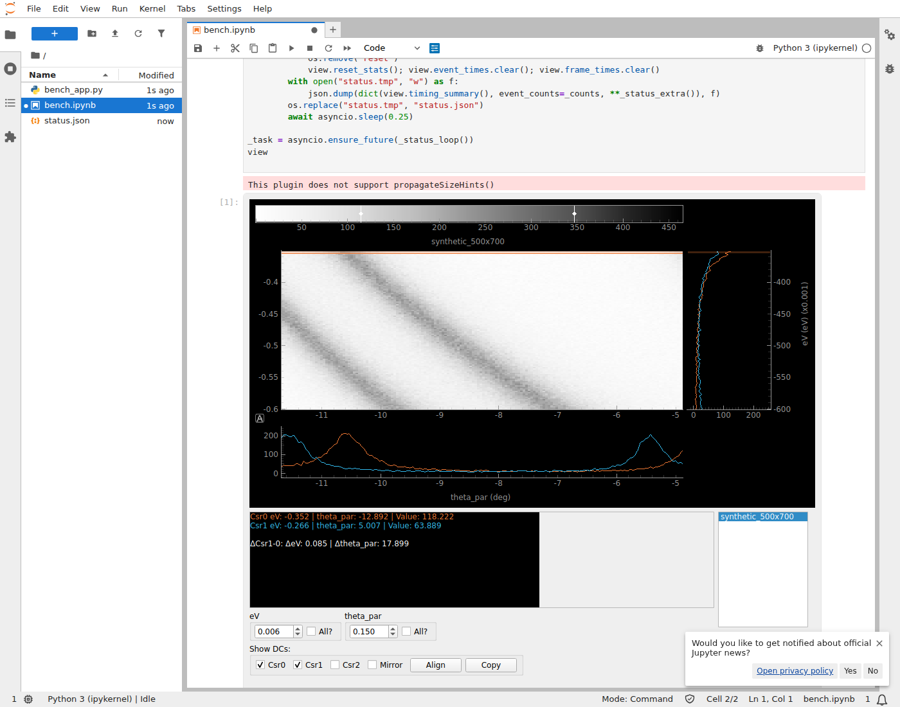

# PyQtGraph viewers in Jupyter and marimo with `jupyter-rfb`: feasibility study

Experimental and self-contained. Nothing in `peaks/` was changed. Delete this folder to remove it.

**Result:** the existing peaks `_Disp2D` runs unmodified inside JupyterLab and marimo.
Dragging its own crosshair updates its own two cuts at a delivered 30 FPS (58 FPS with a
one-line jupyter_rfb JS tweak). Median pointer-to-visible latency is 60–80 ms, and lag does
not accumulate. This uses no desktop window, no `%gui qt` and no Qt event loop.
**Recommendation: A, a full QWidget/RFB adapter**, with the conditions listed at the end.



## Files

| File | Purpose |
|---|---|
| `standalone_rfb.py` | Experiment A: image, crosshair and linked EDC/MDC cuts on `pyqtgraph.jupyter.GraphicsLayoutWidget`. `--native` runs the same layout in a normal Qt window as the baseline. |
| `qwidget_rfb.py` | Experiment B: `QWidgetRFB(RemoteFrameBuffer)` wraps **any** top-level QWidget. `disp_rfb(data)` wraps the real `_Disp2D`. ~185 lines. |
| `marimo_demo.py` | Experiment C: the same widget through `mo.ui.anywidget`. |
| `demo_jupyter.ipynb` | Demo notebook for A and B. |
| `test_qt_rfb.py` | Headless smoke tests (11) covering rendering, event delivery and lifetime. |
| `bench_headless.py` | Server-side timing per drag step, RFB path vs a native window under Xvfb. |
| `bench_browser.py` | End-to-end timing: JupyterLab or `marimo run`, driven by headless Chromium (Playwright). |
| `results/` | Raw JSONL results quoted below, plus two screenshots. |

## Running

```bash
pip install -e ".[dev]" jupyter_rfb simplejpeg marimo      # simplejpeg: fast JPEG encoding
cd experiments/qt_rfb

jupyter lab demo_jupyter.ipynb        # run cells, drag the crosshair targets
marimo edit marimo_demo.py            # press Run; or: marimo run marimo_demo.py
python standalone_rfb.py --native     # native baseline window; prints timings every 2 s

QT_QPA_PLATFORM=offscreen pytest .    # smoke tests
QT_QPA_PLATFORM=offscreen python bench_headless.py rfb
xvfb-run -s "-screen 0 1920x1080x24" python bench_headless.py native
pip install playwright && playwright install chromium
python bench_browser.py [--frontend marimo] [--configs B-medium,B-large]
RFB_MOVE_THROTTLE_MS=10 python bench_browser.py     # see "Frame rate cap" below
```

In the notebook, **click the widget once before using the wheel or keyboard**: jupyter_rfb only
forwards those when the widget has focus. On a Linux host with no display, Qt's `offscreen`
platform is selected automatically. With a display the normal platform is used, and the window
is never mapped (see below).

## How B works

1. `widget.setAttribute(WA_DontShowOnScreen)` followed by `show()`. Qt treats the widget as
   visible, so layouts, polish and paint all work, but it is never mapped. Under Xvfb/xcb,
   `xwininfo` reports the RFB viewer as `IsUnMapped` while a native `_Disp2D` in the same
   process is `IsViewable`.
2. `get_frame()`: run `processEvents()`, then `widget.render()` into a QImage that wraps a
   NumPy RGBX buffer (no copy). This renders the whole window, including Qt controls.
3. `handle_event()`: browser events are converted to `QMouseEvent`, `QWheelEvent` or
   `QKeyEvent` and sent to the widget's **QWindow**. Qt's own `QWidgetWindow` then picks the
   child under the pointer (normally the `GraphicsView` viewport), translates coordinates and
   keeps the implicit grab for drags, so no peaks code needs to know about it. After
   `processEvents()`, it calls `request_draw()`.
4. Nothing in `_Disp2D`, `_Crosshair` or the cut code was changed or re-implemented.

## Test conditions

Lima VM: Ubuntu 26.04 aarch64, 8 vCPU, 9 GB RAM, no GPU. Browser, Jupyter/marimo server and
kernel all ran in the same VM over localhost. Python 3.13.15, pyqtgraph 0.14.0, PyQt6/Qt
6.12.0, jupyter_rfb 1.0.2, anywidget 0.11.0, ipywidgets 8.1.9, ipykernel 6.31.0, JupyterLab
4.6.5, marimo 0.25.2, numpy 2.5.4, simplejpeg 1.9.0, Playwright 1.64.1 with Chromium headless
shell 156 (rAF measured at 61 Hz). Encoding used jupyter_rfb defaults: JPEG quality 80 during
interaction, a lossless PNG 300 ms after the last frame, and `max_buffered_frames=2`.

Data: synthetic ARPES-like dispersions, **medium** 500×700 and **large** 2000×2000 (eV ×
θ). Framebuffers: A 650×600, B 650×770 (the `_Disp2D` default), each at DPR 1 and 2. The
browser runs used DPR 1 only (see Limitations).

## Results

### Server-side cost per drag step (headless, medians in ms, p95 in brackets)

| Path | Data | Frame px | Event + cut update | Render | JPEG q80 | **Total** | JPEG size |
|---|---|---|---|---|---|---|---|
| A `pyqtgraph.jupyter` | medium | 650×600 | 1.4 | 6.2 | 4.6 | **12.3** (14.7) | 51 kB |
| A | large | 650×600 | 1.7 | 6.5 | 4.4 | **12.6** (14.1) | 54 kB |
| A | medium | 1300×1200 (DPR 2) | 0.5 | 3.6 | 9.1 | **13.3** (14.3) | 143 kB |
| B `_Disp2D` | medium | 650×770 | 6.3 | 3.5 | 3.1 | **12.9** (14.4) | 94 kB |
| B | large | 650×770 | 6.2 | 3.7 | 3.1 | **13.0** (14.8) | 94 kB |
| B | medium | 1300×1540 (DPR 2) | 5.4 | 4.8 | 9.5 | **19.9** (21.7) | 239 kB |
| B | large | 1300×1540 (DPR 2) | 5.5 | 5.1 | 9.6 | **20.2** (21.5) | 239 kB |
| **Native** A, Xvfb | medium / large | window | event + paint 8.4 / 9.0 (p95 10.3) | | | | |
| **Native** B, Xvfb | medium / large | window | event + paint 12.8 / 13.1 (p95 16–17) | | | | |

* The existing `_Disp2D._update_DC` (both cuts) takes **0.7 ms** for medium and large data.
  Most of B's 6 ms per event is the existing per-move handlers, mainly the cursor-stats text
  built with xarray `.sel()`. The same code costs the same in the native window.
* Image size barely matters, because the image is not re-rendered when the crosshair moves.
* The RFB pipeline costs about the same per frame as native event + paint. The server can
  sustain 50–75 frames/s, so it is not the bottleneck.
* A anomaly: A renders faster at DPR 2 than at DPR 1 (3.6 vs 6.2 ms). This reproduced on
  repeat runs, but I did not investigate it.

### End-to-end in the browser (DPR 1, synthetic 60 Hz pointer moves, medians)

Latency = browser `pointermove` → the next frame `` loaded → next animation frame.
It includes the JS move throttle, websocket, kernel, render, encode and decode. It excludes
OS input latency and display scan-out. Settle = last pointer move → last motion frame. Similar
settle times for 2 s and 8 s drags mean **no accumulating lag**. The final crosshair position
matched the final pointer to ≤ 1.2 px in every run.

| Frontend | Config | Latency median (max) | FPS 2 s / 8 s drag | Settle 2 s / 8 s |
|---|---|---|---|---|
| Jupyter | A medium | 66 (78) ms | 30.0 / 29.9 | 117 / 119 ms |
| Jupyter | A large | 62 (68) ms | 30.0 / 30.0 | 117 / 118 ms |
| Jupyter | **B medium** | **70 (78) ms** | **29.1 / 29.8** | **68 / 51 ms** |
| Jupyter | **B large** | **72 (103) ms** | **29.1 / 29.4** | **51 / 67 ms** |
| marimo | A medium | 66 (69) ms | 57.9 / 59.4 † | 68 / 66 ms |
| marimo | **B medium** | **80 (87) ms** | **29.7 / 29.9** | **68 / 68 ms** |
| marimo | **B large** | **77 (90) ms** | **29.5 / 29.8** | **50 / 66 ms** |
| Jupyter, 10 ms throttle | A medium | 51 (63) ms | 57.6 / 59.5 | 83 / 83 ms |
| Jupyter, 10 ms throttle | B medium | 75 (88) ms | 55.5 / 29.9 ‡ | 52 / 67 ms |
| Jupyter, 10 ms throttle | **B large** | **58 (110) ms** | **57.5 / 57.6** | **69 / 67 ms** |

† marimo + A: `pyqtgraph.jupyter`'s own redraw hooks produce about 2 frames per pointer
event. Only 30 events/s arrived, so this is not more responsiveness.
‡ In that run headless Chromium delivered only 36 pointer moves/s, because the VM was shared
by browser, server and kernel.

Wheel zoom and wrapper resizing worked in every configuration. The kernel stayed responsive:
an asyncio status task in the same kernel kept writing every 250 ms throughout.

**Frame rate cap (~30 FPS).** jupyter_rfb's JS holds each pointer move for a hard-coded
20 ms. Browsers deliver `pointermove` at display rate (16.7 ms), so only every second move is
forwarded. The kernel log confirmed ~30 moves/s arriving. Setting the throttle below 16 ms
(`RFB_MOVE_THROTTLE_MS=10`, which patches the JS string in `common.rfb_esm`) gave **~58 FPS
for the real `_Disp2D`**, with settle times still flat. Qt is not the limit.

**Native comparison.** Native processing is 8–13 ms per move, so the native viewer runs at
display refresh (60 Hz). Native pointer-to-photon latency could not be measured in a VM with
no physical display. Measured RFB latency (60–80 ms) is therefore about 2–4 display frames
plus the native processing, and the RFB rate is 30 FPS by default against 60 Hz native.
**Subjective smoothness has not been assessed by a person.** All interaction here was
synthetic. A manual check on a desktop browser is still needed.

## What works

* The unmodified `_Disp2D` is visible inline in JupyterLab and in marimo (`edit` and `run`).
* Dragging its existing crosshairs updates its existing EDC/MDC cuts, the cursor-stats text and
  the span markers. Dragging next to a crosshair pans the plot instead, so the drag goes to
  the correct item.
* Mouse-wheel zoom, wrapper resize (Qt relayout), and clicking Qt controls (e.g. the `Csr2`
  checkbox) all work.
* Keyboard after clicking the plot: arrow keys move crosshair 0, through the existing key
  handlers.
* No desktop window appears, and the kernel is not blocked.
* No IPython-specific Qt set-up is needed. The same code runs in marimo.
* After `close()`, the widget is deleted, and late events or draws are ignored rather than
  crashing (tested).

## What does not work / unsupported in the prototype

* **Popups and dialogs** are separate top-level windows and are not rendered. This covers
  menus, pyqtgraph right-click menus, the colorbar colormap menu and the export dialog. An open
  invisible popup swallows the next click. **`_Disp2D`'s Help menu runs a modal
  `QMessageBox`, which blocked the kernel indefinitely**, so the adapter hides the
  `QMainWindow` menu bar. pyqtgraph's right-click menus use non-blocking `popup()` and do not hang.
* **Key auto-repeat**: jupyter_rfb drops repeated `keydown` events, so holding an arrow key moves
  the crosshair one step only.
* **Wheel and keys need focus**: click the widget first, otherwise the page scrolls.
* **Re-executing a cell leaks the old viewer.** Neither marimo nor ipywidgets closes replaced
  widgets: in marimo the count of live `_Disp2D` objects went 1 → 2 → 3 → 4 over three re-runs.
  There was no crash. Call `view.close()` for now. In Jupyter I expect the same ipywidgets
  behaviour, but did not measure it.
* **`marimo run` with several sessions**: each session's kernel runs in its own thread, but Qt
  must stay on one thread. The second session gets a clear `RuntimeError` from the adapter's
  thread check instead of a crash. Single-session `marimo run` and `marimo edit` work.
* No Qt cursor shapes, tooltips, clipboard-to-browser or touch handling. **Copy** uses
  `pyperclip` on the kernel host, not the browser. Double-click is mapped but untested.
* **HiDPI is only verified server-side.** Playwright's `device_scale_factor` reports
  `devicePixelContentBoxSize` in CSS pixels, which makes jupyter_rfb compute half the logical
  size. Those browser runs were discarded. Server cost at DPR 2 is measured above (≈20 ms per
  frame, 240 kB JPEG), but this still needs a manual check on a real Retina display.
* `_Disp3D` and `_Disp4D` were not tried. They should work through the same wrapper.
* Cosmetic: Qt's offscreen plugin prints `This plugin does not support propagateSizeHints()`
  into the cell output.

## Qt event-loop and thread findings

* No Qt event loop is needed. `processEvents()` in `handle_event` and `get_frame` services
  layouts and update requests. A frame rendered after a drag matched a fresh render exactly, so
  no stale final frame was found. Qt **timers** will not fire between browser events;
  `_Disp2D` does not use them.
* All frontend callbacks (ipykernel comms, marimo's anywidget bridge) ran on the thread that
  created the QApplication. The adapter checks this and raises instead of risking a Qt abort.
* jupyter_rfb draws only when an asyncio loop is running in the thread where traitlets fire;
  otherwise it silently skips the draw. That condition held in JupyterLab, `marimo edit` and `marimo run`.
* Global positions: `QGraphicsScene` hit-tests **wheel** events with the global position. Passing
  the local position as global (as `pyqtgraph.jupyter` does) made the wheel miss the plot once the
  window was not at (0, 0). `_Disp2D` sits at (100, 100). Fixed by mapping through the QWidget.
  With `WA_DontShowOnScreen`, the QWindow position does not follow `move()`; the regression test
  covers that.
* pyqtgraph drops scene move events that arrive faster than `mouseRateLimit`. Browser events come
  at ≤ 50–100 Hz, so this is fine, but synthetic tests must be paced (they use 20 ms).
* Running alongside native `disp()` windows (`%gui qt6`) in the same kernel was not tested.

## Upstream limitations

* **jupyter_rfb**:
  * hard-coded 20 ms move throttle (the 30 FPS cap)
  * drops key auto-repeat
  * forwards wheel events only when focused
  * the JPEG encoder rejects RGBA, so alpha is sliced off with a copy (~1.5 ms per frame)
  * silent no-draw without a running asyncio loop

  The throttle patch here edits the JS source string, which is brittle. A configurable
  throttle would be a small upstream PR.
* **pyqtgraph.jupyter**:
  * renders only the `GraphicsView` scene (no QWidgets)
  * passes local positions as global ones
  * never calls `processEvents()`
  * disables plot menus

  Experiment B does not depend on it beyond reusing its button/modifier lookup tables.

## Estimated changes for a production backend

1. Move `QWidgetRFB` into `peaks/core/GUI/GUI_utils/`, and add an opt-in backend switch (e.g.
   `opts.gui.backend = "notebook"`) used by `show_viewer()`. The public `disp()` API stays the same.
   Apply `opts.gui.max_viewers` and close the previous viewer on re-execution (viewer registry,
   plus marimo's cell lifecycle).
2. Popups: composite `QApplication.activePopupWidget()` into the frame and route events to it
   while it is open. Replace `_Disp2D`'s modal Help `QMessageBox.exec()` with something
   non-blocking, or show help as notebook HTML.
3. Configurable move throttle (upstream or a maintained subclass), key auto-repeat on the server
   side, Qt cursor → CSS `cursor` mapping, and a light periodic `processEvents()` pump while
   visible, for Qt timers.
4. Validate `_Disp3D` and `_Disp4D`. Test on real desktop browsers including HiDPI, and on a
   remote/JupyterHub kernel (240 kB per frame at DPR 2 is ~7 MB/s at 30 FPS; consider capping DPR
   or JPEG quality).
5. Multi-session `marimo run` would need all Qt work on one dedicated thread. Leave this out of
   scope unless it is required.

Items 1–3 stay inside the adapter and need no changes to the plotting or numerical code, except
the Help dialog.

## Recommendation

**A. Full QWidget/RFB adapter.** Injecting events at the QWindow level gives the whole
existing window, with Qt controls, focus, keyboard and drag grabs, in about 185 lines and with
no peaks changes. Performance meets the provisional targets: 30 FPS by default and about
58 FPS with the throttle tweak. Latency is under 100 ms in nearly all steps, with one 103 ms
and one 110 ms maximum. The time is spent in transport and throttling, not in Qt.

The open problems are popups and modal dialogs, viewer lifetime, and validation on real
browsers, HiDPI and remote kernels. All of them can be handled in the adapter, so nothing
points to B (scene-level) or C (another transport). Before committing to production, a person
should still try it interactively on a desktop browser and a Retina display.
